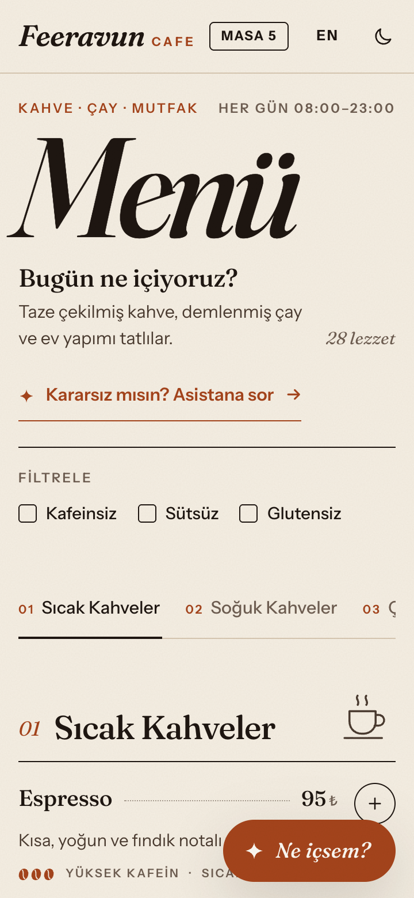
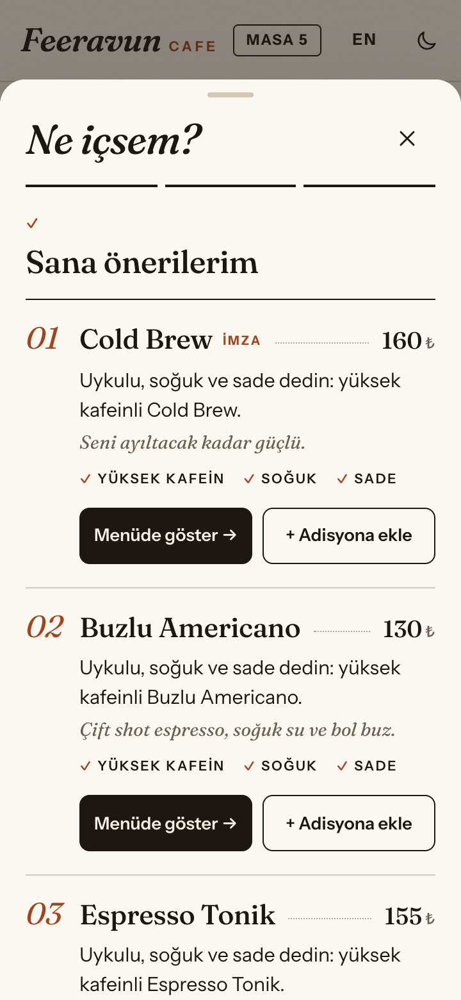
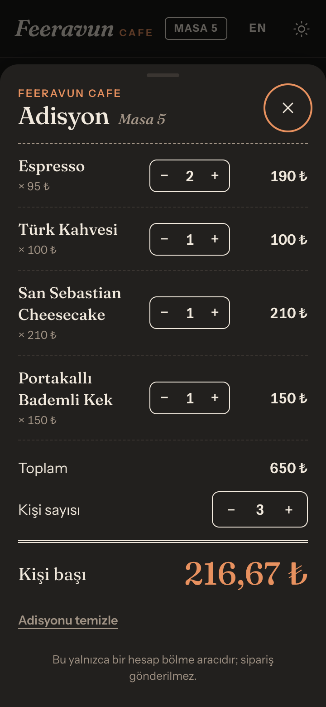
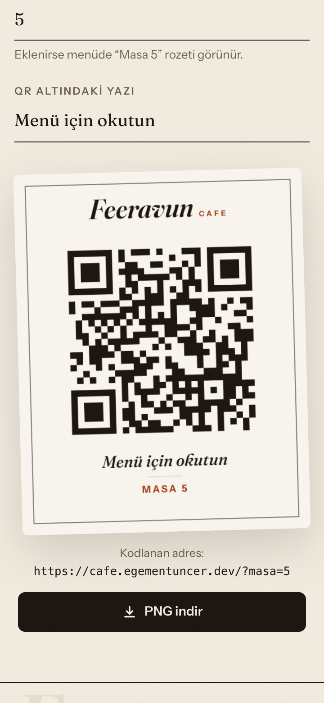

# Feeravun Cafe — Dijital QR Menü

Kurgusal bir kafe için **mobil öncelikli dijital QR menü** demosu. Masadaki QR kodu okutan misafir; kategorilere göre menüyü gezer, alerjen ve kafein bilgisini görür, filtreler, masadaki hesabı böler. Kararsız kalırsa **“Ne içsem? ✦”** asistanı üç soruda ona bir içecek önerir.

> Feeravun Cafe kurgusal bir markadır. Gerçek bir marka adı, logo ya da ürün görseli kullanılmamıştır; ürün fotoğrafı yerine kategori başına basit çizgi SVG illüstrasyonlar kullanılır.
> Bu proje [egementuncer.dev](https://egementuncer.dev) portföyü için hazırlanmıştır.

**Canlı demo:** https://cafe.egementuncer.dev · **QR oluşturucu:** https://cafe.egementuncer.dev/qr.html

---

## Ekran görüntüleri

| Menü (açık tema) | “Ne içsem?” asistanı | Adisyon (koyu tema) | QR oluşturucu |
| :---: | :---: | :---: | :---: |
|  |  |  |  |

---

## Tasarım

Arayüz bir uygulama ekranından çok **basılı bir kafe menüsü** gibi tasarlandı:

- **Kâğıt ve mürekkep paleti:** krem kâğıt, espresso rengi mürekkep, tek bir terrakota vurgu rengi. Koyu temada antrasit zemin ve sıcak krem metin kullanılır. Hafif kâğıt dokusu yalnızca açık temada vardır.
- **Tipografi:** başlıklar, ürün adları ve fiyatlarda *Fraunces* (italik “Menü” başlığı dahil), arayüz metinlerinde *Instrument Sans*.
- **Menü düzeni:** numaralı bölümler (01–05), isim ile fiyat arasında noktalı çizgi, ince ayraçlar, “İmza” ürün işareti, kahve çekirdeği ikonlarıyla kafein seviyesi ve klasik harf kodlarıyla alerjenler (S, G, K, Y, Su). Kodların açıklaması menünün sonundadır.
- **Adisyon:** hesap bölme çekmecesi kesik çizgili bir adisyon fişi gibi görünür.
- **QR kartı:** indirilen PNG, masaya konacak çerçeveli, basılı bir kart olarak tasarlanmıştır.

## Özellikler

### ✦ “Ne içsem?” asistanı (öne çıkan özellik)

Sağ alttaki yüzen butonla açılan, alttan kayan panelde 3 adımlı mini quiz:

1. **Şu an nasıl hissediyorsun?** → Uykulu · Enerjik · Stresli · Keyifli
2. **Sıcak mı, soğuk mu?**
3. **Tatlı mı, sade mi?**

Cevaplar, ürünlerin etiketleri (`temp`, `taste`, `body`) ve kafein seviyesiyle **kural tabanlı bir puanlamada** eşleştirilir. Sonuçta en iyi 2–3 içecek gösterilir; her biri için kısa bir **“neden bu?”** açıklaması bulunur:

> *Uykulu, soğuk ve sade dedin: yüksek kafeinli Cold Brew.*

- Hangi kriterin tuttuğu ✓ işaretleriyle görünür (kafein · sıcaklık · tat).
- **Menüde göster** paneli kapatır, ürüne kaydırır, kartı vurgular ve odağı karta taşır.
- **Adisyona ekle** ile öneri doğrudan hesaba eklenir.
- **Yanına iyi gider:** seçimlere göre bir tatlı veya atıştırmalık önerilir.
- **Tekrar dene** quiz'i baştan başlatır.
- Aktif filtreler (ör. *Sütsüz*) asistana da uygulanır.

**Puanlama** (`js/recommend.js`, DOM'dan bağımsız saf fonksiyonlar):

```
puan = ruh hali puanı + sıcaklık puanı + tat puanı
```

| Ruh hali | Kafein: yok / düşük / orta / yüksek | Ek eğilim |
| --- | --- | --- |
| Uykulu | −4 / 0 / +3 / **+5** | — |
| Enerjik | +1 / +2 / +2 / 0 | hafif +1, doyurucu −1 |
| Stresli | **+5** / +3 / −1 / −4 | hafif +1 |
| Keyifli | 0 / +1 / +2 / 0 | doyurucu +2, tatlı +1 |

Sıcaklık tutarsa **+4**, tutmazsa **−5**; tat tutarsa **+3**, tutmazsa **−2**. Önerileri değiştirmek için yalnızca dosyanın başındaki `WEIGHTS`, `RESULT_LIMITS` ve `PAIRING` tablolarını düzenlemeniz yeterli.

### Menü

- 5 kategori, 28 ürün: Sıcak Kahveler, Soğuk Kahveler, Çaylar, Tatlılar, Atıştırmalıklar.
- Her üründe ad, açıklama, fiyat (₺), kafein seviyesi (yok/düşük/orta/yüksek), alerjenler (süt, gluten, kuruyemiş, yumurta, susam) ve etiketler (sıcak/soğuk, tatlı/sade, hafif/doyurucu) bulunur.
- Yapışkan kategori sekmeleri: tıklayınca ilgili bölüme yumuşak kaydırma; sayfa kaydırıldıkça aktif sekme ve kayan alt çizgi güncellenir.
- **TR / EN** dil seçeneği. Tüm metinler `data/menu.json` içinden gelir; seçim `localStorage`'da hatırlanır (try/catch ile, gizli modda da çalışır).
- **Açık / koyu tema:** varsayılan olarak sistem tercihini izler, manuel geçiş hatırlanır. Tema, sayfa boyanmadan önce uygulanır; yanıp sönme olmaz.
- QR'daki `?masa=5` parametresi başlıkta **“Masa 5”** rozeti gösterir.

### Filtreler

**Kafeinsiz**, **Sütsüz**, **Glutensiz** seçenekleri birlikte kullanılabilir. Uymayan ürünler soluklaşır ve “Filtrelerine uymuyor” etiketi alır. Uygun ürün sayısı ekran okuyuculara da duyurulur.

### Masada hesap bölme (Adisyon)

Ürün satırındaki **+** butonu ürünü *adisyona* ekler; buton adedi gösterir. Alttaki adisyon çubuğu toplam tutarı gösterir. Açılan çekmecede adetler değiştirilebilir, **kişi sayısı (1–10)** seçilir ve **kişi başı tutar** hesaplanır. Kişi başı tutar kuruşa yukarı yuvarlanır, böylece toplam her zaman karşılanır. Bu yalnızca bir hesaplayıcıdır, sipariş göndermez.

### QR oluşturucu (`qr.html`)

İşletmelere yönelik “QR'ınızı buradan alırsınız” demosu. Menü bağlantısı, isteğe bağlı masa numarası ve alt yazı girilir; önizleme anında güncellenir ve **PNG indir** butonu 1200×1500 px, baskıya uygun bir kart indirir. QR etrafında okunabilirlik için en az 4 modüllük boşluk bırakılır.

### Erişilebilirlik ve kalite

- Semantik HTML (`header`, `main`, `nav`, `section`, başlık hiyerarşisi), “Menüye atla” bağlantısı.
- İkon butonlarda `aria-label`; filtre seçeneklerinde `aria-pressed`; aktif sekmede `aria-current`.
- Quiz ve adisyon, native `<dialog>` ile açılır. Odak panelde tutulur, **Esc** veya arka plana tıklama paneli kapatır, odak açan butona geri döner. Her quiz adımında odak soruya taşınır.
- `prefers-reduced-motion` açıksa GSAP animasyonları ve CSS geçişleri kapanır.
- 360 px genişlikte yatay kaydırma olmadan çalışır.
- Meta açıklaması, canonical, Open Graph ve Twitter kartı, manifest, `robots.txt`, `sitemap.xml`.

**Lighthouse (mobil, yerel ölçüm):**

| Sayfa | Performance | Accessibility | Best Practices | SEO |
| --- | :---: | :---: | :---: | :---: |
| `index.html` | 100 | 100 | 100 | 100 |
| `qr.html` | 100 | 100 | 100 | 100 |

---

## Teknolojiler

- **HTML, CSS, vanilla JavaScript** (ES modülleri). Framework ve build adımı yok.
- **[GSAP 3](https://gsap.com/)** (cdnjs): giriş animasyonları, panel ve quiz geçişleri.
- **[qrcode-generator](https://github.com/kazuhikoarase/qrcode-generator)** (cdnjs, ~20 KB): QR matrisi. Çizim canvas üzerinde yapılır.
- **Google Fonts:** Fraunces (başlıklar, ürün adları) + Instrument Sans (arayüz metni). Sayfanın çizimini engellemeyecek şekilde yüklenir.
- **Cloudflare Pages:** statik barındırma; `_headers` ile önbellek ve güvenlik başlıkları.

## Dosya yapısı

```
.
├── index.html            # Menü
├── qr.html               # QR oluşturucu
├── css/style.css         # Tüm stiller (tema token'ları, bileşenler)
├── js/
│   ├── app.js            # Menü, sekmeler, filtreler, paneller, quiz arayüzü
│   ├── recommend.js      # "Ne içsem?" puanlama kuralları (saf fonksiyonlar)
│   ├── cart.js           # Adisyon ve hesap bölme
│   ├── i18n.js           # TR/EN, metin ve fiyat biçimlendirme
│   ├── theme.js          # Açık/koyu tema (iki sayfada ortak)
│   ├── art.js            # Kategori çizimleri ve küçük SVG ikonlar
│   └── qr.js             # QR sayfası mantığı
├── data/menu.json        # Menü, arayüz metinleri, etiketler ve quiz soruları
├── assets/               # favicon, dokunmatik ikonlar, og-image.png
├── docs/screenshots/     # README görselleri
├── _headers              # Cloudflare Pages başlıkları
├── robots.txt, sitemap.xml, site.webmanifest
└── README.md
```

### Menüyü düzenlemek

Tüm içerik `data/menu.json` dosyasındadır:

```jsonc
{
  "id": "cold-brew",
  "category": "cold-coffee",
  "signature": true,                  // menüde "İmza" işareti
  "price": 160,
  "name": { "tr": "Cold Brew", "en": "Cold Brew" },
  "description": { "tr": "…", "en": "…" },
  "caffeine": "high",                 // none | low | medium | high
  "allergens": [],                    // milk | gluten | nuts | egg | sesame
  "tags": { "temp": "cold", "taste": "plain", "body": "light" }
}
```

Arayüz metinleri `ui.tr` / `ui.en` altında, quiz soruları ve seçeneklerin kısa açıklamaları (`hint`) `quiz.steps` altında bulunur. Kategorilerin `art` alanı `js/art.js` içindeki çizimi seçer (`cup`, `iced`, `teapot`, `cake`, `toast`).

---

## Yerelde çalıştırma

ES modülleri ve `fetch` yüzünden dosyayı doğrudan (`file://`) açmak yerine basit bir sunucu kullanın:

```bash
python3 -m http.server 8787
```

Ardından tarayıcıda `http://localhost:8787` adresini açın. Alternatif olarak `npx serve .` da kullanılabilir.

## Cloudflare Pages'e deploy

**A) Git ile (önerilen)**

1. Projeyi GitHub/GitLab'a gönderin.
2. Cloudflare Dashboard → **Workers & Pages** → **Create** → **Pages** → **Connect to Git**.
3. Depoyu seçin ve ayarları şöyle girin:
   - Framework preset: **None**
   - Build command: _(boş)_
   - Build output directory: `/`
4. **Save and Deploy**. Sonraki her `git push` otomatik olarak yayına alınır.

**B) Wrangler ile doğrudan yükleme**

```bash
npx wrangler pages deploy . --project-name feeravun-cafe
```

**Alan adı değişirse:** `index.html`, `qr.html`, `robots.txt` ve `sitemap.xml` içindeki `https://cafe.egementuncer.dev` adresini yenisiyle değiştirin (canonical ve Open Graph mutlak URL ister):

```bash
grep -rl "cafe.egementuncer.dev" --include="*.html" --include="*.txt" --include="*.xml" . | xargs sed -i '' 's#https://cafe.egementuncer.dev#https://YENI-ALAN-ADI#g'
```

---

## Not

Yapay zekâ destekli geliştirildi; tasarım ve ürün kararları bana ait.
